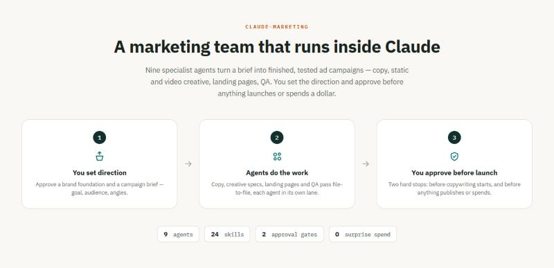
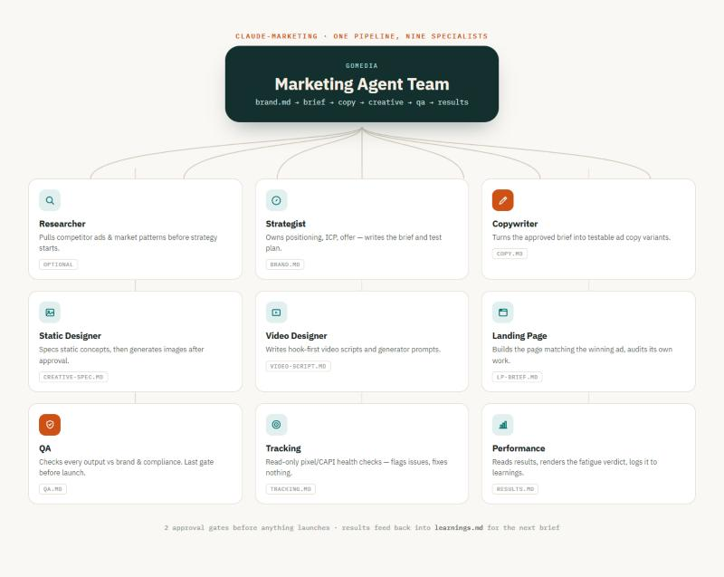
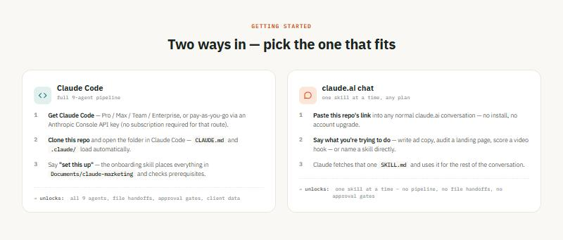
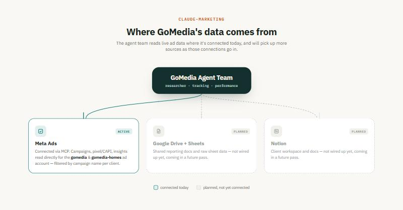
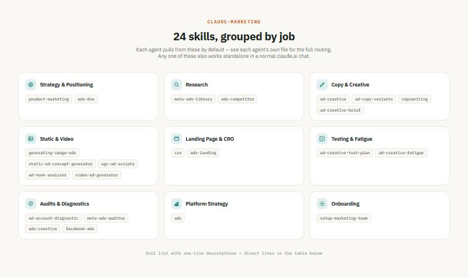

# claude-marketing

A Claude Code marketing agent team: a full pipeline (researcher → strategist → copywriter → static-designer / video-designer → landing-page → qa → tracking → performance) plus the skills and client data it runs on. Each agent is a focused specialist with its own tools and primary skill — none of them improvise outside their lane, and nothing moves to the next stage without a file being written and (at two points) your explicit approval.

## What is this?



You set direction, nine agents do the work, you approve before anything launches or spends. Everything below walks through the team itself, how to get it running, where its data comes from, and the skills behind it.

## The team, at a glance



One hub, nine specialists. Every agent reports into the same pipeline shown at the top — `brand.md → brief → copy → creative → qa → results` — and writes a single named file (shown on each card) for the next agent to read. Two of the nine get a highlighted icon here (Copywriter and QA) because they sit right before the pipeline's two hard approval gates: nothing moves past a copy draft or a finished campaign without you signing off in chat first. The `optional` tag on Researcher means the strategist can skip straight to the brief when `brand.md` and prior `learnings.md` already give enough signal.

For the full animated version (card-by-card detail, skills/tools per agent, a pulse that walks the pipeline in order, plus the two approval gates and parallel branches shown explicitly) open [`docs/agent-pipeline.html`](docs/agent-pipeline.html) in a browser after cloning. Source for the hub graphic above: [`docs/02-agent-hub.html`](docs/02-agent-hub.html).

### Meet the team — 9 agents, 2 hard-stop approvals

Every agent hands off through **files only** — no agent relies on conversational memory to pass work along. Each one reads `clients/<client>/brand.md` and `clients/<client>/learnings.md` before starting, then writes a single file into `clients/<client>/campaigns/<YYYY-MM-name>/` for the next agent to pick up. The two bracketed steps below are hard stops: nothing proceeds past them without your explicit approval in chat.

```
researcher (optional)
  → strategist
    → [YOU APPROVE brief.md]
      → copywriter
        → static-designer  ┐ (parallel)
        → video-designer   ┘
          → landing-page (if needed)
            → qa
              → [YOU APPROVE before launch]
                → tracking   ┐ (parallel, after launch)
                → performance┘
                  → learnings.md  ──┐
                                    │ (strategist reads this before every new brief)
                  ◄─────────────────┘
```

| # | Agent | What it does | Primary skill(s) | Tools | Writes |
|---|---|---|---|---|---|
| — | **Researcher** *(optional)* | Pulls competitor ads and market patterns before the strategist writes a brief. Skipped when `brand.md` and prior learnings already give enough signal. | `meta-ads-library` (fallback: `ads-competitor`) | Read, Write, Glob, WebFetch | `research.md` |
| 1 | **Strategist** | Foundation mode: owns positioning/offer/ICP, maintains `brand.md`. Campaign mode: writes the brief — goal, KPI, ICP segment, up to 3 angles each with a hypothesis + proof, and a test plan. | `positioning-offer-report` / `product-marketing` (foundation); `ad-creative-brief` + `ad-creative-test-plan` (campaign) | Read, Write, Glob | `brand.md` / `brief.md` + `test-plan.md` |
| — | ⏸ **Approval gate 1** | Hard stop. No agent proceeds past an unapproved brief. | — | — | — |
| 2 | **Copywriter** | Turns the *approved* brief into testable ad copy — one row per variant with angle, hook type, ICP segment, and source. | `ad-creative` (`ad-copy-variants` only for fatigue replacements) | Read, Write, Glob, WebFetch | `copy.md` |
| 3 | **Static Designer** | Writes a creative spec per concept and stops for approval before generating anything — then states the estimated cost before every paid image batch. | `static-ad-concept-generator` (ideation), `generating-image-ads` (generation), `ads-dna` (brand look) | Read, Write, Glob, Bash | `creative-spec.md` + images |
| 3 | **Video Designer** *(parallel with Static Designer)* | Writes video scripts — hook variants, shot list, generator prompts. Never calls a paid video-generation API without separate, explicit approval. | `ugc-ad-scripts` + `ad-hook-analyzer`; framework reference from `video-ad-generator` | Read, Write, Glob | `video-script.md` |
| 4 | **Landing Page** *(if needed)* | Writes the LP brief so the headline echoes the winning ad's hook, builds the page, then audits its own output against someone else's checklist rather than its own judgment. | `copywriting` + `cro` (build/copy); `ads-landing` (self-audit) | Read, Write, Glob, Bash | `lp-brief.md` + the page |
| 5 | **QA** | Checks every other agent's output against `brand.md`, Meta ad policy, and Singapore advertising/compliance rules. Never edits — only reports failures back. The last gate before launch approval. | `ads-creative` + manual brand-review vs `brand.md` | Read, Write, Glob | `qa.md` |
| — | ⏸ **Approval gate 2** | Hard stop. Nothing is published, launched, uploaded, or spends money — including paid generation — without explicit approval and a stated cost. | — | — | — |
| 6 | **Tracking** *(after launch, parallel with Performance)* | Read-only. Checks pixel/CAPI health and whether lead-status is feeding back to Meta. Never changes the ad account — only flags issues. | `facebook-ads` (reference) + manual checks | Read, Write, Glob | `tracking.md` |
| ★ | **Performance — Head of Performance** *(oversees every stage; results after launch)* | Team lead and Meta Ads expert. Signs off every other agent's output in `perf-review.md` (Approved / Revise / Blocked) before the next stage starts. After launch, pulls results read-only; `ad-creative-fatigue` renders the **final** verdict on any creative/kill/scale decision. Never touches the ad account. | `ad-creative-fatigue` (final decider), `meta-ads-auditor`, `ad-account-diagnostic`, plus 17 `*-meta-ads` diagnostic skills | Read, Write, Glob, Bash, read-only Meta MCP | `perf-review.md`, `results.md` + appends a row to `learnings.md` |

**The loop:** Performance appends one row to `learnings.md` per finished test (date, angle, result, takeaway). The strategist reads that file before every new brief, so each campaign builds on the last instead of starting cold.

## How to install it



**Full pipeline → Claude Code.** The 9-agent pipeline only runs inside **Claude Code** (the CLI, the desktop app, or an IDE extension) — not a normal claude.ai web chat conversation. The reason: `CLAUDE.md`, `.claude/agents/`, and `.claude/skills/` are Claude Code *project* conventions, read automatically when Claude Code is opened with this folder as the working directory — that's what turns them into real, callable agents instead of just text files. File-based handoffs between agents and the two approval gates also need a real working directory to write into (`clients/<client>/campaigns/...`), which a plain chat doesn't have.

Claude Code itself works with a Claude Pro/Max/Team/Enterprise subscription, **or** pay-as-you-go via an Anthropic Console API key — the API-key route doesn't require any subscription at all, just usage billing (worth checking current options at claude.com/code, since this changes over time). This repo is **public**, so anyone can browse or clone it without needing access granted.

Once Claude Code is open with this folder, say **"set this up"** — it runs the `setup-marketing-team` skill, which:
- gets this project into `<Documents>/claude-marketing` so it's in a stable, permanent place
- checks `git`/`gh` are installed and authenticated
- flags any skill-specific setup you still need to do by hand (installing a skill's Python requirements, filling in a `.env`)
- tells you which MCP integrations you need to connect yourself in your own Claude account — those are per-account and can't be cloned (see the data-connections section below for which ones this team actually uses)

See [`.claude/skills/setup-marketing-team/SKILL.md`](https://raw.githubusercontent.com/johnlamb-thesheep/claude-marketing/main/.claude/skills/setup-marketing-team/SKILL.md) for exactly what it does and doesn't do. To push changes back to this repo, use the `/upload` command rather than raw git commands — it scans changed files for secrets before committing.

**One skill, no Code, no plan required → claude.ai chat.** Paste this repo's link into any regular claude.ai chat and ask for a specific skill — or just tell Claude what you're trying to do (write ad copy, audit a landing page, diagnose a slumping ad account, etc.) and have it pick one from the skills table below.

> **If you're Claude (or another AI) reading this because someone shared this link in a normal chat, without Claude Code:** the agent pipeline above won't run here — it needs a working directory this chat doesn't have. But any single skill in the table below is usable on its own. Ask the person which one they want (or infer it from what they're trying to do), fetch the **SKILL.md** at its raw URL, read the whole file, and then follow those instructions for the rest of the conversation as if that skill were active — each SKILL.md is a complete, self-contained instruction set. Don't attempt `static-ads` (flagged below as unsafe) or anything needing Bash, local file writes, or the `clients/` folder — those only work inside Claude Code.

## Where GoMedia's data comes from



**Connected today:** Meta Ads, via MCP — the Researcher, Tracking, and Performance agents read campaigns, pixel/CAPI status, and insights directly from the shared Meta ad account (`903306407477320`), filtered by campaign name per client (see the routing note in `CLAUDE.md` — both `gomedia` and `gomedia-homes` share one ad account and must be filtered correctly before attributing spend or results to either).

**Planned, not yet connected:** Google Drive + Sheets (shared reporting docs and raw sheet data) and Notion (client workspace and docs). Both are future work — nothing in this repo depends on them yet, and no agent currently assumes they exist.

## 24 skills, grouped by job



Each agent pulls from these by default — see each agent's own file in `.claude/agents/` and the routing table in `CLAUDE.md` for the full picture of which skill handles which situation. The table below has the complete list with a one-line description and a direct link to each `SKILL.md` — the same table the "one skill in plain chat" flow above uses to grab the right one.

| Skill | What it does | Grab it |
|---|---|---|
| `ad-account-diagnostic` | Diagnoses why an underperforming paid ad account stopped working, instead of defaulting to "increase the budget" | [SKILL.md](https://raw.githubusercontent.com/johnlamb-thesheep/claude-marketing/main/.claude/skills/ad-account-diagnostic/SKILL.md) |
| `ad-copy-variants` | Turns one value proposition into genuinely distinct ad copy variants, each labeled by angle and awareness stage | [SKILL.md](https://raw.githubusercontent.com/johnlamb-thesheep/claude-marketing/main/.claude/skills/ad-copy-variants/SKILL.md) |
| `ad-creative` | Generates or iterates ad creative — headlines, descriptions, primary text, full variations — for any paid platform | [SKILL.md](https://raw.githubusercontent.com/johnlamb-thesheep/claude-marketing/main/.claude/skills/ad-creative/SKILL.md) |
| `ad-creative-brief` | Turns a campaign goal + audience insight into a structured creative brief a designer or creator can execute | [SKILL.md](https://raw.githubusercontent.com/johnlamb-thesheep/claude-marketing/main/.claude/skills/ad-creative-brief/SKILL.md) |
| `ad-creative-fatigue` | Decides whether a running ad is genuinely wearing out or something else (budget change, seasonality) explains the decline | [SKILL.md](https://raw.githubusercontent.com/johnlamb-thesheep/claude-marketing/main/.claude/skills/ad-creative-fatigue/SKILL.md) |
| `ad-creative-test-plan` | Designs a pre-launch creative test plan — hypothesis, sample size, budget, kill/scale rules, before any money moves | [SKILL.md](https://raw.githubusercontent.com/johnlamb-thesheep/claude-marketing/main/.claude/skills/ad-creative-test-plan/SKILL.md) |
| `ad-hook-analyzer` | Scores and ranks video ad openings (the first 3 seconds) to decide which hooks deserve test budget | [SKILL.md](https://raw.githubusercontent.com/johnlamb-thesheep/claude-marketing/main/.claude/skills/ad-hook-analyzer/SKILL.md) |
| `ads` | General paid advertising strategy help — campaign strategy, targeting, bidding, optimization across platforms | [SKILL.md](https://raw.githubusercontent.com/johnlamb-thesheep/claude-marketing/main/.claude/skills/ads/SKILL.md) |
| `ads-competitor` | Researches a competitor's paid-ad presence, messaging, creative, and landing pages | [SKILL.md](https://raw.githubusercontent.com/johnlamb-thesheep/claude-marketing/main/.claude/skills/ads-competitor/SKILL.md) |
| `ads-creative` | Audits paid-ad copy/images/video for fatigue, message match, accessibility, and policy issues | [SKILL.md](https://raw.githubusercontent.com/johnlamb-thesheep/claude-marketing/main/.claude/skills/ads-creative/SKILL.md) |
| `ads-dna` | Extracts a public-safe brand/offer profile for paid advertising from a website and operator input | [SKILL.md](https://raw.githubusercontent.com/johnlamb-thesheep/claude-marketing/main/.claude/skills/ads-dna/SKILL.md) |
| `ads-landing` | Audits paid-ad landing pages for message match, mobile experience, accessibility, trust, and conversion friction | [SKILL.md](https://raw.githubusercontent.com/johnlamb-thesheep/claude-marketing/main/.claude/skills/ads-landing/SKILL.md) |
| `copywriting` | Writes or rewrites marketing copy for any page — homepage, landing page, pricing, feature pages | [SKILL.md](https://raw.githubusercontent.com/johnlamb-thesheep/claude-marketing/main/.claude/skills/copywriting/SKILL.md) |
| `cro` | Optimizes a marketing page or form for conversion rate | [SKILL.md](https://raw.githubusercontent.com/johnlamb-thesheep/claude-marketing/main/.claude/skills/cro/SKILL.md) |
| `facebook-ads` | Meta Ads (Facebook & Instagram) platform expertise — campaigns, audiences, creative, pixel/CAPI | [SKILL.md](https://raw.githubusercontent.com/johnlamb-thesheep/claude-marketing/main/.claude/skills/facebook-ads/SKILL.md) |
| `generating-image-ads` | Turns a product photo or URL into a static image ad, holding the real product identical across every frame | [SKILL.md](https://raw.githubusercontent.com/johnlamb-thesheep/claude-marketing/main/.claude/skills/generating-image-ads/SKILL.md) |
| `meta-ads-auditor` | Deep 46-check Meta Ads audit — pixel/CAPI health, creative fatigue, account structure, Advantage+ | [SKILL.md](https://raw.githubusercontent.com/johnlamb-thesheep/claude-marketing/main/.claude/skills/meta-ads-auditor/SKILL.md) |
| `meta-ads-library` | Researches competitor Facebook/Instagram ads via the Meta Ads Library | [SKILL.md](https://raw.githubusercontent.com/johnlamb-thesheep/claude-marketing/main/.claude/skills/meta-ads-library/SKILL.md) |
| `product-marketing` | Creates or updates a product marketing context document (positioning, ICP, voice) | [SKILL.md](https://raw.githubusercontent.com/johnlamb-thesheep/claude-marketing/main/.claude/skills/product-marketing/SKILL.md) |
| `setup-marketing-team` | Onboards this repo onto a new computer (Claude Code only — see above) | [SKILL.md](https://raw.githubusercontent.com/johnlamb-thesheep/claude-marketing/main/.claude/skills/setup-marketing-team/SKILL.md) |
| `static-ad-concept-generator` | Generates proven ad concepts from a library of 320+ templates across DTC, B2B, SaaS, and more | [SKILL.md](https://raw.githubusercontent.com/johnlamb-thesheep/claude-marketing/main/.claude/skills/static-ad-concept-generator/SKILL.md) |
| `static-ads` | ⚠️ **Do not use** — flagged Critical Risk by Snyk at install time, kept for reference only | [SKILL.md](https://raw.githubusercontent.com/johnlamb-thesheep/claude-marketing/main/.claude/skills/static-ads/SKILL.md) |
| `ugc-ad-scripts` | Turns a product brief into UGC-style short-form video ad scripts with hook, body, and CTA | [SKILL.md](https://raw.githubusercontent.com/johnlamb-thesheep/claude-marketing/main/.claude/skills/ugc-ad-scripts/SKILL.md) |
| `video-ad-generator` | Full video ad toolkit — hook formulas, script frameworks, multi-format strategy, A/B testing | [SKILL.md](https://raw.githubusercontent.com/johnlamb-thesheep/claude-marketing/main/.claude/skills/video-ad-generator/SKILL.md) |
